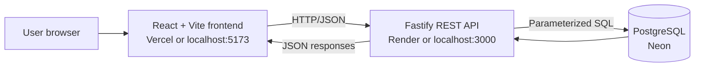
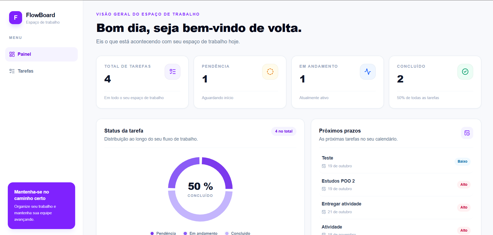
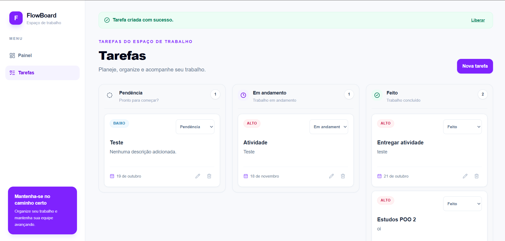
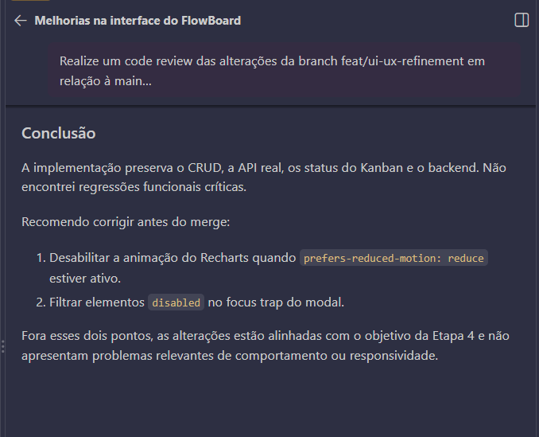

# FlowBoard

FlowBoard is a full-stack task management application built to explore a
practical, AI-assisted software development workflow. It combines a focused
dashboard, a Kanban board, REST APIs, PostgreSQL persistence, and a responsive
React interface.

The project is designed as an MVP: simple enough to understand, but complete
enough to demonstrate planning, implementation, validation, debugging, and
deployment preparation.

## Project Overview

FlowBoard helps users organize work through three task stages:

- **To do**
- **In progress**
- **Done**

The dashboard summarizes the current workload, while the Kanban view supports
day-to-day task organization. The local environment provides the complete CRUD
workflow. The public demonstration is designed to be read-only, with write
operations protected in both the frontend and backend.

## Features

- Dashboard with total task statistics by status.
- Kanban board with `todo`, `in_progress`, and `done` columns.
- Create, edit, delete, and inspect tasks during local development.
- Change task status directly from the Kanban board.
- Low, medium, and high priority levels.
- Optional due dates with date validation and formatted display.
- Backend validation for titles, priorities, statuses, UUIDs, and dates.
- Loading skeletons, empty states, retry actions, and accessible error messages.
- Success feedback after confirmed operations.
- Responsive layout for mobile, tablet, and desktop viewports.
- Keyboard-friendly modal interactions and visible focus states.
- Reduced-motion support for UI transitions and chart animation.
- Public read-only mode controlled by environment variables.
- Explicit CORS configuration without wildcard origins.

### Local CRUD and public demo behavior

| Environment | Read operations | Write operations |
| --- | --- | --- |
| Local development | Enabled | Enabled |
| Public demo | Enabled | Blocked with HTTP 403 |

The frontend hides task mutation controls when demo mode is enabled. The
backend independently blocks `POST`, `PUT`, `PATCH`, and `DELETE` requests, so
the public safety rule does not depend on frontend behavior.

## Tech Stack

| Layer | Technologies |
| --- | --- |
| Frontend | React, Vite, React Router, Tailwind CSS v4 |
| Visualization | Recharts |
| UI icons | Lucide React |
| Backend | Node.js, Fastify, `@fastify/cors` |
| Database | PostgreSQL |
| Database hosting | Neon |
| Frontend deployment | Vercel |
| Backend deployment | Render |
| Testing | Node.js Test Runner, Fastify `inject` |
| Development support | GitHub Copilot with human review |

The application uses JavaScript with ES modules. No additional test framework
is required by the backend.

## Architecture

The frontend communicates with the backend through a small REST service layer.
The backend validates requests, executes parameterized PostgreSQL queries, and
returns JSON responses. Database credentials remain server-side.



### Runtime boundaries

- `frontend/src/services/api.js` is the frontend boundary for REST requests.
- `backend/src/app.js` creates the Fastify application and configures CORS.
- `backend/src/routes/tasks.js` defines task and dashboard endpoints.
- `backend/src/db/connection.js` creates the PostgreSQL pool from
  `DATABASE_URL`.
- `backend/src/server.js` starts the production-compatible HTTP server.

## Project Structure

```text
flowboard/
├── frontend/
│   ├── src/
│   │   ├── components/
│   │   │   ├── dashboard/
│   │   │   └── tasks/
│   │   ├── layout/
│   │   ├── pages/
│   │   ├── services/
│   │   └── utils/
│   ├── .env.example
│   └── package.json
├── backend/
│   ├── src/
│   │   ├── db/
│   │   ├── routes/
│   │   ├── app.js
│   │   └── server.js
│   ├── tests/
│   ├── .env.example
│   └── package.json
├── .github/
│   └── copilot-instructions.md
└── README.md
```

### Main frontend responsibilities

- `src/pages/Dashboard.jsx`: dashboard metrics, chart, and upcoming tasks.
- `src/pages/Tasks.jsx`: Kanban page, notices, retry state, and task modal.
- `src/components/tasks/KanbanBoard.jsx`: status columns and task grouping.
- `src/components/tasks/TaskCard.jsx`: task presentation and local action
  controls.
- `src/components/TaskModal.jsx` and `src/components/TaskForm.jsx`: task
  creation and editing.
- `src/services/api.js`: centralized HTTP requests.

### Main backend responsibilities

- `src/app.js`: Fastify instance, CORS, health endpoints, and read-only
  protection.
- `src/routes/tasks.js`: request schemas, validation, CRUD routes, status
  updates, and dashboard aggregation.
- `src/db/schema.sql`: PostgreSQL schema.
- `tests/tasks.test.js`: isolated route tests using a fake database and
  Fastify `inject`.

## API Endpoints

### General endpoints

| Method | Route | Description |
| --- | --- | --- |
| `GET` | `/` | Returns the API welcome message. |
| `GET` | `/health` | Returns the service health status. |

### Task and dashboard endpoints

| Method | Route | Description | Local | Public demo |
| --- | --- | --- | --- | --- |
| `GET` | `/tasks` | Lists tasks ordered by creation date. | Allowed | Allowed |
| `GET` | `/tasks/:id` | Returns one task by UUID. | Allowed | Allowed |
| `POST` | `/tasks` | Creates a task. | Allowed | `403` |
| `PUT` | `/tasks/:id` | Replaces a task. | Allowed | `403` |
| `PATCH` | `/tasks/:id/status` | Updates a task status. | Allowed | `403` |
| `DELETE` | `/tasks/:id` | Deletes a task. | Allowed | `403` |
| `GET` | `/dashboard/summary` | Returns total counts by status. | Allowed | Allowed |

The API also supports CORS preflight requests through `OPTIONS`. Only origins
listed in `CORS_ORIGIN` are accepted.

## Getting Started

### Prerequisites

- Node.js with npm.
- A PostgreSQL database for the backend.
- A database connection string assigned to `DATABASE_URL`.

### 1. Configure the backend

```bash
cd backend
copy .env.example .env
```

Edit `backend/.env` with a local or development PostgreSQL connection string.
For local development, use:

```env
PORT=3000
DATABASE_URL=your_development_database_url
CORS_ORIGIN=http://localhost:5173
DEMO_READ_ONLY=false
```

Do not commit `.env` files or database credentials.

### 2. Start the backend

```bash
cd backend
npm install
npm run dev
```

The API listens on `http://localhost:3000`.

### 3. Configure and start the frontend

```bash
cd frontend
copy .env.example .env
npm install
npm run dev
```

The Vite development server runs on `http://localhost:5173`. The local
frontend configuration should contain:

```env
VITE_API_URL=http://localhost:3000
VITE_DEMO_MODE=false
```

### Useful commands

| Directory | Command | Purpose |
| --- | --- | --- |
| `frontend` | `npm run dev` | Starts Vite development server. |
| `frontend` | `npm run lint` | Runs ESLint. |
| `frontend` | `npm run build` | Creates the production build. |
| `frontend` | `npm run preview` | Serves the production build locally. |
| `backend` | `npm run dev` | Starts Fastify with Node watch mode. |
| `backend` | `npm start` | Starts Fastify without watch mode. |
| `backend` | `npm test` | Runs the Node test suite. |

## Environment Variables

### Frontend

Frontend variables are exposed to browser code by Vite, so they must not
contain secrets.

| Variable | Example | Purpose |
| --- | --- | --- |
| `VITE_API_URL` | `http://localhost:3000` | Backend base URL. |
| `VITE_DEMO_MODE` | `false` | Hides mutation controls when `true`. |

### Backend

| Variable | Example | Purpose |
| --- | --- | --- |
| `PORT` | `3000` | HTTP port; Render supplies its production value. |
| `DATABASE_URL` | `your_development_database_url` | PostgreSQL connection string. |
| `CORS_ORIGIN` | `http://localhost:5173` | Explicit comma-separated allowed origins. |
| `DEMO_READ_ONLY` | `false` | Blocks task mutations when `true`. |
| `NODE_ENV` | `production` | Production also enables backend read-only protection. |

`DATABASE_URL` must only exist in the backend environment. Never place it in a
`VITE_*` variable or commit it to the repository.

## Deployment

The planned production architecture separates the public frontend, API, and
database:

1. Build and host the React/Vite frontend on **Vercel**.
2. Run the Fastify API on **Render**.
3. Host PostgreSQL on **Neon**.
4. Configure Vercel's `VITE_API_URL` with the public Render API URL.
5. Configure Render's `DATABASE_URL` with the Neon connection string.
6. Configure Render's `CORS_ORIGIN` with the exact Vercel origin.
7. Set `DEMO_READ_ONLY=true` on the public backend.
8. Set `VITE_DEMO_MODE=true` on the public frontend.

### Vercel configuration

- Root directory: `frontend`
- Build command: `npm run build`
- Output directory: `dist`
- Required variable: `VITE_API_URL`
- Public demo variable: `VITE_DEMO_MODE=true`

### Render configuration

- Root directory: `backend`
- Start command: `npm start`
- Required variables: `DATABASE_URL`, `CORS_ORIGIN`
- Recommended production variables: `NODE_ENV=production`,
  `DEMO_READ_ONLY=true`
- The server listens on `0.0.0.0` and uses the `PORT` value supplied by Render.

No deployment is performed automatically by this repository.

## AI-Assisted Development

GitHub Copilot was used as a development assistant across the project
lifecycle, not as a replacement for engineering judgment.

### Planning

- Reviewed the existing architecture and active frontend flow before changes.
- Defined incremental UI/UX and production-readiness phases.
- Kept frontend, backend, API contracts, and database responsibilities
  separated.

### Implementation

- Used Copilot to explore relevant files and propose focused changes.
- Applied incremental improvements to responsive layouts, accessibility,
  loading states, error handling, and read-only demo behavior.
- Preserved existing endpoints, status values, SQL behavior, and local CRUD.

### Debugging and testing

- Investigated real runtime failures such as date formatting and DELETE
  requests with an empty JSON content type.
- Added and ran backend tests using the Node Test Runner, Fastify `inject`,
  and an isolated fake database.
- Validated frontend changes with ESLint and Vite production builds.

### Code review

- Reviewed changes against the intended UI/UX and production scope.
- Checked accessibility, reduced-motion behavior, responsive behavior,
  environment separation, CORS, and public write protection.
- Human review remained responsible for accepting changes, checking
  assumptions, and deciding what is safe to publish.

## Screenshots

### Dashboard

<p align="center">
  
</p>

### Kanban Board

<p align="center">
  
</p>

### AI-Assisted Workflow

<p align="center">
  
</p>

## Live Demo

The public demo URL has not been confirmed in this repository yet.

When the Vercel deployment is available, add the verified URL here:

`<!-- Live demo: https://your-confirmed-vercel-domain.example -->`

## License

No license has been declared in the repository yet.
